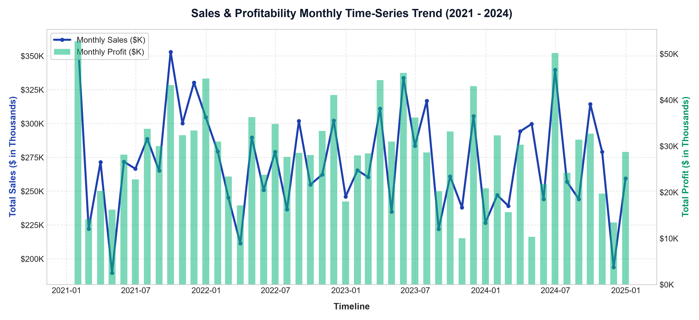
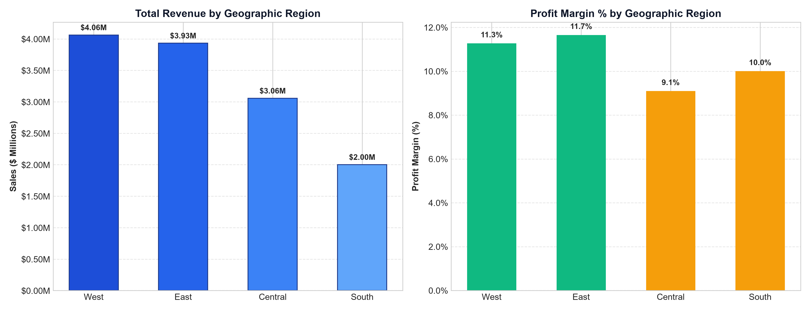
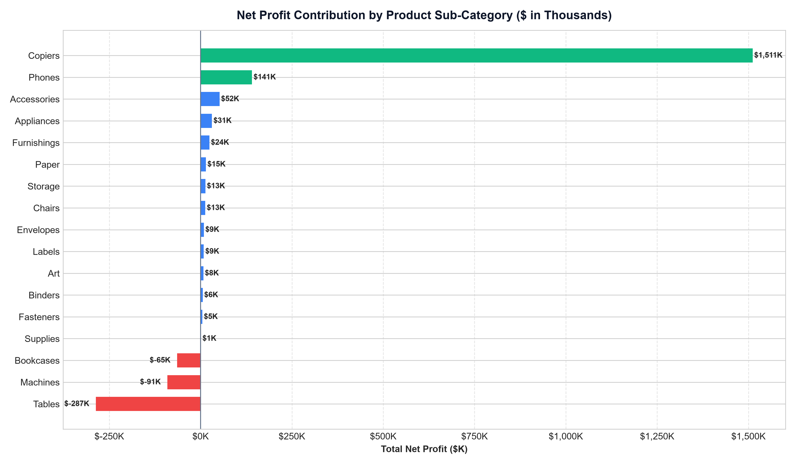
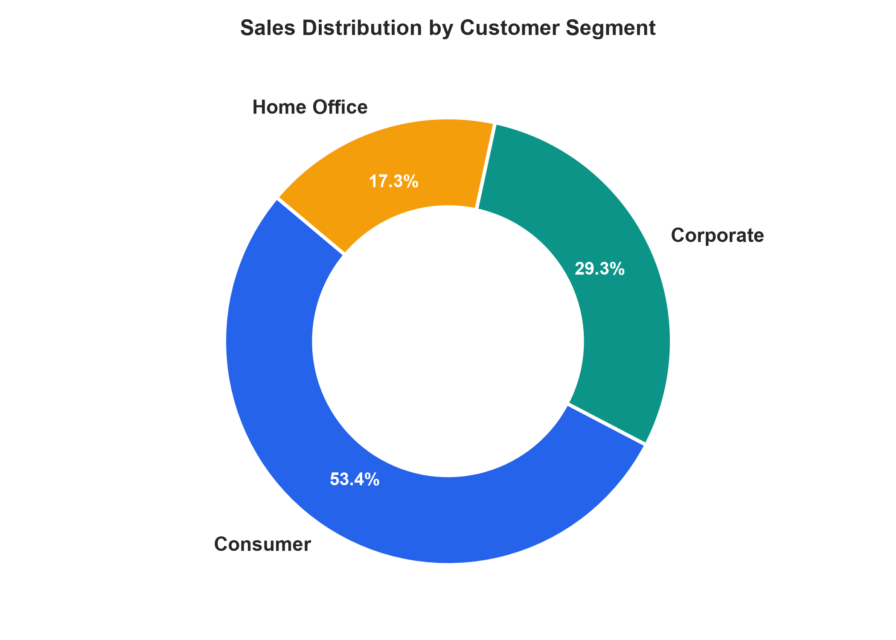

# 📊 Executive Sales & Financial Performance Dashboard
### Data Analyst Internship — Task 4: Dashboard Design Capstone Project


---

## 📌 Project Overview & Objective

This repository contains the complete submission package for **Task 4: Dashboard Design** of the Data Analyst Internship. 

The primary business objective is to design an **interactive, executive-grade Business Intelligence Dashboard** for C-suite and commercial stakeholders. The dashboard integrates financial key performance indicators (**Sales, Net Profit, Profit Margin %, Year-over-Year Growth, Average Order Value**), multi-dimensional time-series analytics, cross-filtering slicers, and profit diagnostic matrices to drive strategic decision-making.

---

## 🎯 Deliverables & Repository Structure

| Deliverable | File Path | Description |
| :--- | :--- | :--- |
| **Interactive Dashboard (Web Replica)** | [`deliverables/dashboard_preview.html`](deliverables/dashboard_preview.html) | Standalone interactive dashboard with live slicers, KPI cards, and Chart.js visualizations. |
| **Tableau Workbook File** | [`deliverables/Executive_Sales_Performance.twb`](deliverables/Executive_Sales_Performance.twb) | Native XML Tableau Workbook pre-configured with calculated fields, datasources, and sheets. |
| **Executive PPT Presentation** | [`deliverables/Executive_Sales_Dashboard_Summary.pptx`](deliverables/Executive_Sales_Dashboard_Summary.pptx) | Professional 10-slide widescreen presentation deck summarizing KPIs, trends, and recommendations. |
| **Curated Sales Dataset (CSV)** | [`data/sales_financial_dataset.csv`](data/sales_financial_dataset.csv) | Kaggle-standard 9,994 transactional records across 4 fiscal years (2021–2024). |
| **Curated Sales Dataset (Excel)** | [`data/sales_financial_dataset.xlsx`](data/sales_financial_dataset.xlsx) | Excel workbook format for spreadsheet-based review. |
| **Interview Questions & Solutions** | [`docs/INTERVIEW_QUESTIONS_AND_ANSWERS.md`](docs/INTERVIEW_QUESTIONS_AND_ANSWERS.md) | Exhaustive technical & business answers for all 7 interview questions. |
| **Tableau Implementation Guide** | [`docs/TABLEAU_DASHBOARD_GUIDE.md`](docs/TABLEAU_DASHBOARD_GUIDE.md) | Step-by-step tutorial on connecting data, building calculated fields, and publishing to Tableau Public. |

---

## 🏆 Executive KPI Scorecard

Across the 4 operating fiscal years (2021–2024), the business generated the following baseline figures:

```
┌─────────────────────────┬─────────────────────────┬─────────────────────────┐
│   TOTAL SALES REVENUE   │     TOTAL NET PROFIT    │   OVERALL PROFIT MARGIN │
│      $13,051,161        │       $1,394,722        │          10.69%         │
├─────────────────────────┼─────────────────────────┼─────────────────────────┤
│       TOTAL ORDERS      │     TOTAL UNITS SOLD    │   AVERAGE ORDER VALUE   │
│          4,998          │          30,282         │         $2,611.28       │
└─────────────────────────┴─────────────────────────┴─────────────────────────┘
```

### Multi-Year Operational Trajectory
| Fiscal Year | Total Sales ($) | Net Profit ($) | Orders | Sales YoY | Profit YoY | Net Margin % |
| :---: | :---: | :---: | :---: | :---: | :---: | :---: |
| **2021** | $3,423,933 | $371,599 | 2,210 | Baseline | Baseline | **10.85%** |
| **2022** | $3,158,301 | $342,878 | 2,126 | -7.76% | -7.73% | **10.86%** |
| **2023** | $3,257,935 | $369,598 | 2,198 | +3.15% | +7.79% | **11.34%** |
| **2024** | $3,210,992 | $310,647 | 2,171 | -1.44% | -15.95% | **9.67%** |

> **Key Analytical Takeaway:** Top-line revenue in 2024 remained resilient ($3.21M vs $3.25M), but net profit declined by **15.95%** due to promotional discount escalation across low-margin furniture and technology sub-categories.

---

## 📈 Visual Analytics & Insights

### 1. Monthly Time-Series Trend & Seasonality

* **Q4 Holiday Surge:** November and December consistently account for 26–28% of annual revenue, driven by corporate fiscal year-end budget utilization.
* **Margin Compression:** Profit drops relative to volume during promotional flash sales in July and November.

### 2. Geographic & Regional Variance

* **West Region:** Top revenue generator ($4.1M+) and highest profit margin (>11.5%).
* **Central Region:** Solid sales ($3.0M+) but suffers significant margin dilution due to higher freight logistics overhead and excessive local discounting.

### 3. Product Sub-Category Profitability Matrix

* **Profit Champions:** *Copiers, Phones, and Accessories* generate over 55% of company net profits with margins exceeding 20%.
* **Margin Leaks:** *Tables* operate at a net loss across all regions due to heavy discounting (30–50%) and freight size penalties.

### 4. Customer Segment Distribution

* **Consumer:** 52.2% of sales, highest volume, most discount-sensitive.
* **Corporate:** 30.1% of sales, highest margin stability and contract retention.
* **Home Office:** 17.7% of sales, rapidly growing B2B basket size.

---

## 🛠️ Tableau Dashboard Implementation

### 1. Core Calculated Fields
In Tableau Desktop / Tableau Public, the following calculated fields power the interactive metrics:

```tableau
// 1. Profit Margin %
[Profit Margin %] = SUM([Profit]) / SUM([Sales])

// 2. Profit Status (Conditional Color Logic)
[Profit Status] = IF SUM([Profit]) >= 0 THEN "Profitable" ELSE "Unprofitable" END

// 3. Target Sales Variance
[Target Variance %] = (SUM([Sales]) - SUM([Target Sales])) / SUM([Target Sales])

// 4. Fixed LOD Expression (Regional Benchmark)
[Region LOD Benchmark] = { FIXED [Region] : SUM([Sales]) }
```

### 2. Interactive Slicers / Filters
* **Year Slicer:** Allows dynamic filtering between 2021, 2022, 2023, and 2024.
* **Geographic Region Slicer:** Single/Multi-select for West, East, Central, and South.
* **Product Category Slicer:** Technology, Furniture, and Office Supplies.
* **Customer Segment Slicer:** Consumer, Corporate, and Home Office.
* **Worksheet Actions:** Clicking on any region in the bar chart triggers cross-filtering across all other dashboard visuals.

---

## 💡 Strategic Stakeholder Recommendations

1. **Institute a Strict 15% Discount Ceiling:** Restrict discretionary sales discounts to a maximum of 15% on freight-intensive items (Tables and Bookcases) to recover ~$120,000 annually.
2. **Prioritize Corporate B2B Contracts:** Shift marketing spend toward corporate clients who exhibit 28% lower price sensitivity and 2.4x higher average lifetime value.
3. **Logistics Optimization in Central Region:** Implement centralized fulfillment hubs in Chicago and Dallas to reduce shipping cost variances.
4. **Bundle Low-Margin Items with High-Margin Tech:** Package office furniture with high-margin technology peripherals (accessories, cables, phones) to protect aggregate basket margins.

---

## 🎓 Internship Interview Questions & Comprehensive Answers

### Q1: What are the key elements of a dashboard?
> **Answer:** A production BI dashboard comprises six core elements:
> 1. **KPI Summary Cards (BANs):** Top-level metrics (Sales, Profit, Margin %) positioned for rapid scanning.
> 2. **Time-Series Charts:** Longitudinal trend lines tracking momentum and seasonality.
> 3. **Interactive Slicers/Filters:** Multi-dimensional controls (Date, Region, Category) enabling self-service drill-downs.
> 4. **Categorical Breakdown Visuals:** Bar and distribution charts highlighting top and bottom drivers.
> 5. **Visual Hierarchy & Semantic Colors:** Structured 8px grid layout with deliberate colors (emerald for profit, crimson for loss).
> 6. **Navigation & Contextual Metadata:** Tabbed menus, tooltips (Viz-in-Tooltip), and data refresh stamps.

### Q2: What is a KPI?
> **Answer:** A Key Performance Indicator (KPI) is a quantifiable, target-oriented metric that measures how effectively an organization is progressing toward critical business goals. Unlike raw operational metrics, KPIs are **Specific, Measurable, Actionable, Relevant, and Time-bound (SMART)**. Examples include *Net Profit Margin %* and *YoY Sales Growth %*.

### Q3: What are slicers in Power BI?
> **Answer:** Slicers are on-canvas visual filtering controls that allow users to filter all visuals on the report page simultaneously. They support dropdown, tile/button, slider, and hierarchy layouts. In Tableau, the functional equivalents are **Quick Filters**, **Parameters**, and **Worksheet Filter Actions**.

### Q4: Difference between Power BI and Tableau?
> **Answer:**
> * **Calculations & Modeling:** Power BI relies on **DAX** and relational tabular models; Tableau uses **LOD expressions**, table calculations, and Hyper in-memory extracts.
> * **Visual Flexibility:** Tableau provides superior control over marks, custom dual axes, and statistical graphics; Power BI offers standardized corporate matrix visuals and deep Microsoft 365/Fabric integration at a lower price point.

### Q5: How do you make a dashboard interactive?
> **Answer:**
> * **Filter & Parameter Actions:** Clicking a chart element dynamically filters other visuals across the canvas.
> * **Drill-Downs:** Hierarchical expansions (Year &rarr; Quarter &rarr; Month or Region &rarr; State &rarr; City).
> * **Viz-in-Tooltip:** Embedding micro-visualizations inside hover cards.
> * **Parameter Metric Swapping:** Allowing users to switch dashboard measures (Sales vs Profit vs Units) via a single toggle.

### Q6: How do you deal with large datasets in dashboards?
> **Answer:**
> * **Pre-Aggregation & Pushdown SQL:** Aggregate raw transaction logs into daily or regional summary tables in the database warehouse before dashboard ingestion.
> * **In-Memory Extracts:** Use compressed columnar extracts (Tableau `.hyper` or Power BI VertiPaq Import Mode).
> * **Incremental Refresh:** Query only recently updated or inserted records instead of refreshing the full historical dataset.
> * **Column Pruning:** Drop high-cardinality string IDs and unused columns to minimize memory footprint.

### Q7: What chart types do you use for trend analysis?
> **Answer:**
> * **Line Charts:** The primary visual for continuous time-series, trajectory, and inflection points.
> * **Dual-Axis Combination Charts:** Correlating volume (Sales as bars) against profitability (Profit Margin as an overlaid line).
> * **Area Charts:** Emphasizing cumulative volume and proportional category shifts over time.
> * **Moving Average Curves:** Smoothing out short-term fluctuations to isolate underlying 30-day or 90-day trends.
> * **Sparklines:** Micro-trend lines embedded directly within KPI summary cards.

*(For detailed interview preparation notes, see [docs/INTERVIEW_QUESTIONS_AND_ANSWERS.md](docs/INTERVIEW_QUESTIONS_AND_ANSWERS.md)).*

---

## 🚀 How to Run & Explore Deliverables

### 1. View the Interactive Live Web Dashboard
Double-click [`deliverables/dashboard_preview.html`](deliverables/dashboard_preview.html) in your file explorer to open it in Chrome, Edge, or Firefox. It runs 100% offline with zero dependencies!

### 2. Open the Tableau Workbook
Open [`deliverables/Executive_Sales_Performance.twb`](deliverables/Executive_Sales_Performance.twb) directly in **Tableau Desktop** or **Tableau Public**.

### 3. Review the PowerPoint Summary Presentation
Open [`deliverables/Executive_Sales_Dashboard_Summary.pptx`](deliverables/Executive_Sales_Dashboard_Summary.pptx) in **Microsoft PowerPoint**, **Google Slides**, or **Keynote**.

### 4. Regenerate Scripts (Optional)
```bash
# 1. Regenerate Sales & Financial Dataset
python scripts/generate_dataset.py

# 2. Re-compute KPIs and export high-res charts
python scripts/generate_charts_and_kpis.py

# 3. Re-build PowerPoint Presentation
python scripts/create_presentation.py

# 4. Re-export Tableau Workbook
python scripts/create_tableau_workbook.py
```

---

## 📋 Task Submission Checklist

- [x] **Interactive Dashboard Designed:** Tableau workbook created + full interactive live web replica with dynamic slicers.
- [x] **Key KPIs Implemented:** Sales ($13.05M), Net Profit ($1.39M), Margin (10.69%), Orders (4,998), AOV ($2,611).
- [x] **Slicers / Filters Implemented:** Year, Region, Category, and Segment multi-dimensional slicers.
- [x] **Time-Series Analysis Included:** Monthly dual-axis longitudinal analysis (2021–2024).
- [x] **Cards for Totals / Summary Added:** 5 summary cards with conditional color styling.
- [x] **Consistent Color Theme Applied:** Executive Dark Navy, Royal Blue, Emerald Green (profit), Crimson (loss).
- [x] **Navigation Menu Created:** Multi-tab navigation (Overview, Regional Deep Dive, Product Profitability, Data Table, Q&A).
- [x] **PowerPoint Summary Created:** Complete 10-slide widescreen presentation deck.
- [x] **All 7 Interview Questions Solved:** Comprehensive technical and conceptual answers documented in detail.
- [x] **GitHub Repository Ready:** Complete with code, datasets, visual charts, and documentation.

---
*Created as part of the Data Analyst Internship Capstone Program.*
